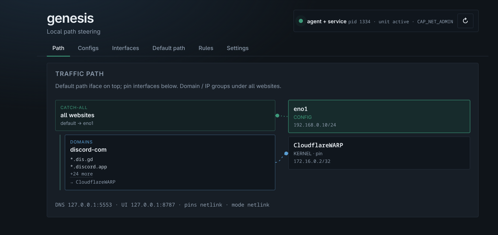

# Genesis

Linux agent that sends DNS and connection traffic over a chosen interface (VPN, NIC) based on domain and IP rules.



| Service | Default address |
|---------|-----------------|
| Web UI  | `http://127.0.0.1:8787` (TCP, localhost only) |
| DNS stub | `127.0.0.1:5553` (UDP) |

Docs: [ctl manual](docs/ctl-manual.md) · [service](docs/service.md) · [resolved coexistence](docs/resolved-coexistence.md) · [architecture](docs/dns-redirector-plan.md)

## Requirements

- Go 1.26 or newer
- git, make
- systemd (for the service)

Fedora:

```bash
sudo dnf install -y golang git make
```

Debian / Ubuntu: install `git` and `make`, and Go 1.26+ from [go.dev/dl](https://go.dev/dl/) if the distro package is older.

## Build

```bash
git clone https://github.com/osmancoskun/genesis.git
cd genesis
make check-deps
make build
```

Binaries: `bin/genesis-agent`, `bin/genesis-ctl`.

## Install

```bash
sudo make install ENABLE=1
```

This installs to `/usr/local`, writes a blank `/etc/genesis/config.yaml` if none exists, and starts `genesis.service`. Open `http://127.0.0.1:8787` to pick a default interface and add rules, or import the Discord example.

Check it:

```bash
genesis-ctl status
```

```
config:   /etc/genesis/config.yaml
web ui:   http://127.0.0.1:8787 (reachable)
dns:      udp 127.0.0.1:5553
pins:     netlink
default:  eno1 (mode netlink)
rules:    1
service:  genesis.service active
```

Uninstall: `sudo make uninstall` (add `PURGE=1` to also remove `/etc/genesis`).

## Configuration

One YAML file for agent settings and rules.

```yaml
version: 1

agent:
  listen: 127.0.0.1:5553       # DNS stub (UDP)
  ui_listen: 127.0.0.1:8787    # Web UI (TCP), "off" disables
  pins: auto                   # auto | dry-run | netlink | noop
  default_path_mode: off       # auto | dry-run | netlink | off
  dns_upstream: 1.1.1.1

defaults:                      # used when a rule leaves a field out
  dns: 1.1.1.1
  interface: auto
  pin_connections: true
  on_iface_down: fail_closed   # fail_closed | fail_open

default_path:                  # where unmatched IPv4 traffic goes
  interface: eno1              # interface name, "auto", or "" for off
  on_iface_down: fail_closed

rules:                         # first match wins
  - name: discord
    match:
      domains: [discord.com, "*.discord.com"]
      ips: []                  # IPv4 or CIDR
    dns: 1.1.1.1
    interface: CloudflareWARP
```

| Section | Purpose |
|---------|---------|
| `agent` | Listen addresses and how routes are applied |
| `defaults` | Values inherited by rules |
| `default_path` | Catch-all interface for traffic no rule matched |
| `rules` | Domain / IP matches sent to a specific interface |

`pins` and `default_path_mode`:

- `netlink`: install policy routes (needs `CAP_NET_ADMIN`)
- `dry-run`: log the routes, change nothing
- `auto`: `netlink` if permitted, otherwise `dry-run`
- `off` / `noop`: disabled

Config location:

- Service: `/etc/genesis/config.yaml`
- Foreground: `-config PATH`, then `$GENESIS_CONFIG`, `configs/local.yaml`, `~/.config/genesis/config.yaml`

Environment overrides: `GENESIS_CONFIG`, `GENESIS_LISTEN`, `GENESIS_UI`.

Example configs:

- `configs/default.config.yaml`: blank, used on first install
- `configs/discord.config.yaml`: Discord over Cloudflare WARP, everything else over `eno1`

Full field reference: [docs/ctl-manual.md](docs/ctl-manual.md).

## genesis-ctl

| Command | Description |
|---------|-------------|
| `genesis-ctl status` | Config path, Web UI address, DNS listen, service state |
| `genesis-ctl service-status` | Web UI / DNS addresses and `systemctl status` |
| `genesis-ctl up` / `down` / `restart` | Start, stop, restart the service |
| `genesis-ctl apply` | Reload config after editing the YAML by hand |
| `genesis-ctl ifaces` | List interfaces |
| `genesis-ctl menu` | Interactive setup |

## Run without installing

```bash
cp configs/discord.config.yaml configs/local.yaml   # edit interface names
go run ./cmd/ctl -config configs/local.yaml run
```

Test DNS: `dig @127.0.0.1 -p 5553 discord.com A`

To route selected domains from the whole system through the agent, enable systemd-resolved split DNS:

```bash
./scripts/host-resolved-modeb.sh install 5553
```

Undo routes and split DNS: `./scripts/host-cleanup.sh`

## Safety

- Uses routing tables 18000–18999, rule priority 5000 (pins) and 5100 (default path).
- Does not modify the main routing table or bring links up/down.

## Fedora RPM

Build and install stay on Make; packaging is Meson-orchestrated:

```bash
make package-rpm
# VERSION_MODE=tag make package-rpm   # exact git tag, no patch bump
```

Version and changelog come from git (see [packaging/fedora/README.md](packaging/fedora/README.md)).
